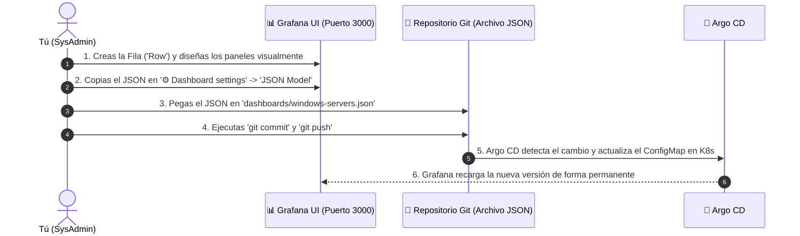

# 📘 Manual Integral de Administración de Infraestructura, GitOps, Monitoreo y Alertas

---

## 📑 Tabla de Contenidos
1. [Resumen de Plataformas y Credenciales](#1-resumen-de-plataformas-y-credenciales)
2. [Procedimiento para Levantar Todos los Servicios y Túneles](#2-procedimiento-para-levantar-todos-los-servicios-y-túneles)
3. [Script de Chequeo de Salud Rápido (Health Check)](#3-script-de-chequeo-de-salud-rápido-health-check)
4. [Procedimiento: Unir Equipos a Wazuh SIEM](#4-procedimiento-unir-equipos-a-wazuh-siem)
5. [Procedimiento: Unir Equipos a Prometheus](#5-procedimiento-unir-equipos-a-prometheus)
6. [Las 11 Métricas de Monitoreo de Windows Server](#6-las-11-métricas-de-monitoreo-de-windows-server)
7. [Sistema de Alertas Automáticas (Prometheus Alert Rules)](#7-sistema-de-alertas-automáticas-prometheus-alert-rules)
8. [Metodología de Diagnóstico de Incidentes y Errores](#8-metodología-de-diagnóstico-de-incidentes-y-errores)
9. [Guía Maestra: Agregar Nuevas Secciones y Paneles a Grafana](#9-guía-maestra-agregar-nuevas-secciones-y-paneles-a-grafana)
10. [Operación y Buenas Prácticas con Argo CD (GitOps)](#10-operación-y-buenas-prácticas-con-argo-cd-gitops)
11. [Matriz de Solución de Problemas Frecuentes (Troubleshooting)](#11-matriz-de-solución-de-problemas-frecuentes-troubleshooting)

---

## 1. Resumen de Plataformas y Credenciales

| Herramienta | URL de Acceso | Usuario | Contraseña | Rol en la Infraestructura |
| :--- | :--- | :--- | :--- | :--- |
| **🚀 Argo CD** | [https://localhost:8080](https://localhost:8080) | `admin` | `-ojxdFMjjVgzD59s` | Despliegue continuo y control GitOps |
| **📊 Grafana** | [http://localhost:3000](http://localhost:3000) | `admin` | `adminPasswordChangeMe` | Visualización de telemetría y dashboards |
| **📈 Prometheus** | [http://localhost:9090](http://localhost:9090) | *(Sin clave)* | *(Sin clave)* | Motor recolector de métricas y evaluación de alertas |
| **🛡️ Wazuh SIEM** | [http://localhost:5601](http://localhost:5601) | *(Acceso directo)* | *(Acceso directo)* | Ciberseguridad, FIM, eventos de Windows y auditoría |

---

## 2. Procedimiento para Levantar Todos los Servicios y Túneles

Si la computadora anfitrión se reinicia, se suspende o se cierran las terminales, sigue este orden para levantar todo:

### Paso 2.1: Verificar que los Pods de Kubernetes estén encendidos
Abre PowerShell y valida los 3 namespaces principales:
```powershell
kubectl get pods -n argocd
kubectl get pods -n monitoring
kubectl get pods -n security
```
*Todos los pods deben mostrar estado `Running` y `1/1` o `2/2`.*

### Paso 2.2: Levantar los 5 Túneles de Red (Port-Forwards) en Segundo Plano
Ejecuta este bloque único en **PowerShell como Administrador** para abrir los accesos web y el puerto de los agentes:

```powershell
# 1. Túnel para Argo CD (Puerto 8080)
Start-Process powershell -ArgumentList "kubectl port-forward --address 0.0.0.0 svc/argocd-server -n argocd 8080:443" -WindowStyle Hidden

# 2. Túnel para Grafana (Puerto 3000)
Start-Process powershell -ArgumentList "kubectl port-forward --address 0.0.0.0 svc/k8s-monitoring-grafana -n monitoring 3000:3000" -WindowStyle Hidden

# 3. Túnel para Prometheus (Puerto 9090)
Start-Process powershell -ArgumentList "kubectl port-forward --address 0.0.0.0 svc/k8s-monitoring-prometheus -n monitoring 9090:9090" -WindowStyle Hidden

# 4. Túnel para Wazuh Dashboard (Puerto 5601)
Start-Process powershell -ArgumentList "kubectl port-forward --address 0.0.0.0 svc/wazuh-dashboard -n security 5601:5601" -WindowStyle Hidden

# 5. Túnel para Agentes de Wazuh (Puertos 1514 y 1515)
Start-Process powershell -ArgumentList "kubectl port-forward --address 0.0.0.0 svc/wazuh-manager -n security 1514:1514 1515:1515" -WindowStyle Hidden
```

---

## 3. Script de Chequeo de Salud Rápido (Health Check)

Copia y pega este script en PowerShell para verificar en 3 segundos si tus 4 plataformas y los agentes están respondiendo:

```powershell
Write-Host "=============================================" -ForegroundColor Cyan
Write-Host "       ESTADO DE TUS 4 PLATAFORMAS           " -ForegroundColor Cyan
Write-Host "=============================================" -ForegroundColor Cyan

$servicios = @(
    @{ Nombre = "🚀 Argo CD";          Puerto = 8080; URL = "https://localhost:8080" },
    @{ Nombre = "📊 Grafana";          Puerto = 3000; URL = "http://localhost:3000" },
    @{ Nombre = "📈 Prometheus";       Puerto = 9090; URL = "http://localhost:9090" },
    @{ Nombre = "🛡️ Wazuh SIEM";       Puerto = 5601; URL = "http://localhost:5601" },
    @{ Nombre = "🔌 Wazuh Agentes";    Puerto = 1514; URL = "Puerto de Eventos (1514)" }
)

foreach ($s in $servicios) {
    $test = Test-NetConnection -ComputerName "127.0.0.1" -Port $s.Puerto -WarningAction SilentlyContinue -InformationLevel Quiet
    if ($test) {
        Write-Host "[ ONLINE  🟢 ] $($s.Nombre) en $($s.URL)" -ForegroundColor Green
    } else {
        Write-Host "[ OFFLINE 🔴 ] $($s.Nombre) (Puerto $($s.Puerto) cerrado o túnel caído)" -ForegroundColor Red
    }
}
Write-Host "=============================================" -ForegroundColor Cyan
```

---

## 4. Procedimiento: Unir Equipos a Wazuh SIEM

Ejecuta este bloque en **PowerShell como Administrador** en cada nuevo equipo Windows (Cliente o Servidor):

```powershell
# 1. Parámetros de configuración
$AGENT_NAME = "NOMBRE_DE_TU_EQUIPO"   # Ejemplo: SRV-BD-01 o CLI-FINANZAS-02
$MANAGER_IP = "10.2.1.70"

# 2. Descargar e instalar silenciosamente el agente
Invoke-WebRequest -Uri https://packages.wazuh.com/4.x/windows/wazuh-agent-4.7.2-1.msi -OutFile "$env:TEMP\wazuh-agent.msi"
msiexec.exe /i "$env:TEMP\wazuh-agent.msi" /q WAZUH_MANAGER=$MANAGER_IP WAZUH_AGENT_NAME=$AGENT_NAME WAZUH_REGISTRATION_SERVER=$MANAGER_IP

# 3. Eliminar archivo de contraseña si existiera (registro directo sin authd.pass)
Remove-Item "C:\Program Files (x86)\ossec-agent\authd.pass" -Force -ErrorAction SilentlyContinue

# 4. Asegurar la IP en la configuración y registrar contra el Manager
(Get-Content "C:\Program Files (x86)\ossec-agent\ossec.conf") -replace '<address>.*?</address>', "<address>$MANAGER_IP</address>" | Set-Content "C:\Program Files (x86)\ossec-agent\ossec.conf"
& "C:\Program Files (x86)\ossec-agent\agent-auth.exe" -m $MANAGER_IP -A $AGENT_NAME

# 5. Iniciar servicio y validar
Start-Service -Name "Wazuh"
Get-Service -Name "Wazuh"
```

---

## 5. Procedimiento: Unir Equipos a Prometheus

### Paso 1: En el Servidor Windows (Instalar Exportador de Métricas)
```powershell
Invoke-WebRequest -Uri https://github.com/prometheus-community/windows_exporter/releases/download/v0.25.1/windows_exporter-0.25.1-amd64.msi -OutFile "$env:TEMP\windows_exporter.msi"
msiexec.exe /i "$env:TEMP\windows_exporter.msi" /qn ENABLED_COLLECTORS="cpu,cs,logical_disk,net,os,service,system" LISTEN_PORT="9182"
```

### Paso 2: En el Repositorio GitOps (`prometheus-config.yaml`)
Agrega el nuevo target bajo el job `windows-servers`:
```yaml
      - job_name: 'windows-servers'
        static_configs:
          - targets: ['10.2.3.225:9182']
            labels:
              instance: 'SERVIDOR_DOMINIO'
              os: 'windows'
              environment: 'production'
              role: 'domain-controller'
          - targets: ['10.2.3.247:9182']
            labels:
              instance: 'SERVIDOR_ARCHIVO'
              os: 'windows'
              environment: 'production'
              role: 'file-server'
```

---

## 6. Las 11 Métricas de Monitoreo de Windows Server

| # | Parámetro | Herramienta | Métrica / Consulta Técnica |
| :--- | :--- | :--- | :--- |
| **1** | **CPU y Carga** | Grafana | `100 - (avg by (instance) (rate(windows_cpu_time_total{mode="idle"}[2m])) * 100)` y `windows_system_processor_queue_length` |
| **2** | **RAM Utilizada / Libre** | Grafana | `windows_os_physical_memory_free_bytes` vs `windows_cs_physical_memory_bytes` |
| **3** | **Disco: Espacio y Uso** | Grafana | `100 * (windows_logical_disk_free_bytes / windows_logical_disk_size_bytes)` |
| **4** | **IOPS y Latencia** | Grafana | `sum by (volume) (rate(windows_logical_disk_reads_total[2m]) + rate(windows_logical_disk_writes_total[2m]))` y latencia en `ms` |
| **5** | **Tráfico de Red** | Grafana | `rate(windows_net_bytes_received_total[2m])` y `rate(windows_net_bytes_sent_total[2m])` |
| **6** | **Errores de Red** | Grafana | `sum(windows_net_packets_outbound_errors_total + windows_net_packets_received_errors_total)` |
| **7** | **Servicios Windows** | Grafana / Wazuh | `windows_service_status{status="ok"}` y visor de servicios |
| **8** | **Procesos e Hilos** | Grafana / Wazuh | `windows_os_processes` (Total) y `windows_system_threads` (Hilos) |
| **9** | **Uptime** | Grafana | `time() - windows_system_system_up_time` |
| **10** | **Cantidad de Conexiones**| Wazuh | `Inventory Data` ➔ `Network Ports` (Sockets TCP/UDP activos) |
| **11** | **Errores de Sistema** | Wazuh | `EventChannel: System` (Logs del Visor de Eventos de Windows) |

---

## 7. Sistema de Alertas Automáticas (Prometheus Alert Rules)

Prometheus evalúa continuamente las reglas de alerta. Cada alerta pasa por una máquina de estados:
* 🟢 **`Inactive`:** Todo normal dentro de los umbrales.
* 🟡 **`Pending`:** Se superó el umbral, pero el sistema espera la ventana `for:` para evitar falsos positivos por picos temporales.
* 🔴 **`Firing`:** La falla persistió más del tiempo configurado. La alarma suena activamente.

### 📋 Las 3 Reglas de Oro Implementadas:

```yaml
  alert_rules.yml: |
    groups:
      - name: windows_servers_alerts
        rules:
          # 1. Caída Total del Servidor
          - alert: WindowsServerDown
            expr: up{job="windows-servers"} == 0
            for: 1m
            labels:
              severity: critical
            annotations:
              summary: "Servidor Windows {{ "{{ $labels.instance }}" }} esta FUERA DE LINEA"
              description: "El servidor {{ "{{ $labels.instance }}" }} ({{ "{{ $labels.role }}" }}) no responde a Prometheus desde hace mas de 1 minuto."

          # 2. Saturación de CPU
          - alert: WindowsHighCpuUsage
            expr: 100 - (avg by (instance) (rate(windows_cpu_time_total{mode="idle"}[2m])) * 100) > 85
            for: 3m
            labels:
              severity: warning
            annotations:
              summary: "Alto consumo de CPU en {{ "{{ $labels.instance }}" }}"
              description: "La CPU de {{ "{{ $labels.instance }}" }} supera el 85% durante mas de 3 minutos (Valor actual: {{ "{{ $value }}" }}%)."

          # 3. Poco Espacio en Disco
          - alert: WindowsDiskSpaceLow
            expr: 100 * (windows_logical_disk_free_bytes{volume=~"[A-Z]:"} / windows_logical_disk_size_bytes{volume=~"[A-Z]:"}) < 15
            for: 2m
            labels:
              severity: critical
            annotations:
              summary: "Poco espacio en disco {{ "{{ $labels.volume }}" }} en {{ "{{ $labels.instance }}" }}"
              description: "El volumen {{ "{{ $labels.volume }}" }} en {{ "{{ $labels.instance }}" }} tiene menos del 15% libre (Valor actual: {{ "{{ $value }}" }}%)."
```

> [!IMPORTANT]
> **Regla de Oro en Helm:** Siempre que uses variables de Prometheus como `$labels.instance` o `$value` dentro de plantillas de Helm, debes envolverlas como `{{ "{{ $labels.instance }}" }}`. De lo contrario, `helm lint` fallará con el error `undefined variable "$labels"`.

---

## 8. Metodología de Diagnóstico de Incidentes y Errores

Cuando una alerta se dispara en rojo (`firing`), se sigue este protocolo de investigación:

```
[1. Prometheus: Identificar Host y Error Técnico] ➔ [2. Grafana: Comportamiento Previo] ➔ [3. Wazuh: Causa Raíz en Windows]
```

### Paso 8.1: En Prometheus (Menú Status ➔ Targets)
* Ve a **[http://localhost:9090/targets](http://localhost:9090/targets)**:
  * Si dice `DOWN`, revisa la columna **`Error`**:
    * `dial tcp ...: connect: connection refused` ➔ El equipo está encendido pero el servicio `windows_exporter` se detuvo.
    * `context deadline exceeded` (Timeout) ➔ El equipo está apagado o el Firewall de Windows bloqueó el puerto `9182`.
* Ve a **[http://localhost:9090/alerts](http://localhost:9090/alerts)** para ver etiquetas, severidad y la hora de inicio (`Active Since`).

### Paso 8.2: En la Consola PromQL (Menú Graph)
Consulta en vivo las alertas activas con:
```promql
ALERTS{alertstate="firing"}
```
O consulta la salud directa de los servidores:
```promql
up{job="windows-servers"}
```

### Paso 8.3: En Wazuh SIEM (Visor de Eventos Centralizado)
Filtra por `agent.name: "SERVIDOR_AFECTADO"` para encontrar el código de evento de Windows:
* **Event ID `7036` / `7034`:** Servicio detenido manualmente o colapsado inesperadamente (*Service crashed*).
* **Event ID `1074` / `6008`:** Apagado controlado por usuario o apagado repentino por fallo eléctrico / Pantallazo Azul (*BSOD*).
* **Event ID `4625`:** Múltiples contraseñas fallidas por RDP (posible ataque de fuerza bruta previo a la caída).

---

## 9. Guía Maestra: Agregar Nuevas Secciones y Paneles a Grafana

Para administrar tableros de forma profesional sin perder cambios, se sigue el ciclo **Diseño Visual ➔ Exportación JSON ➔ Sincronización GitOps**.



### Paso a Paso para Crear una Nueva Sección:
1. **Crear la Fila:** En Grafana (`http://localhost:3000`), haz clic en **Add** ➔ **Row** (ej: *5. Monitoreo de Base de Datos SQL Server*).
2. **Agregar Panel:** Haz clic en **Add** ➔ **Visualization** ➔ Datasource: `Prometheus` ➔ Ingresa la fórmula PromQL y umbrales.
3. **Exportar JSON:** Clic en el engranaje **⚙️ (Dashboard settings)** ➔ **JSON Model** ➔ Copiar todo (`Ctrl + A`, `Ctrl + C`).
4. **Guardar en Git:** Pega el contenido en [`monitoring/k8s-monitoring/dashboards/windows-servers.json`](file:///C:/Users/HRC-SOPORTE-01/Desktop/infraestructura-repo/monitoring/k8s-monitoring/dashboards/windows-servers.json).
5. **Desplegar con GitOps:**
   ```powershell
   helm lint monitoring/k8s-monitoring
   git add monitoring/k8s-monitoring/dashboards/windows-servers.json
   git commit -m "feat(monitoring): agregar nueva seccion al dashboard"
   git push origin main
   kubectl annotate application k8s-monitoring -n argocd argocd.argoproj.io/refresh=hard --overwrite
   kubectl rollout restart deployment/k8s-monitoring-grafana -n monitoring
   ```

---

## 10. Operación y Buenas Prácticas con Argo CD (GitOps)

1. **Git es la Única Fuente de Verdad:** Nunca edites configuraciones con `kubectl edit` manual; cualquier cambio fuera de Git será sobreescrito por Argo CD.
2. **Significado de Estados en Argo CD:**
   * 🟢 **Synced & Healthy:** El clúster coincide exactamente con lo escrito en GitHub.
   * 🟡 **OutOfSync:** Hay commits nuevos en GitHub pendientes de aplicarse.
   * 🔴 **Degraded:** Un pod o servicio falló y requiere inspección de logs.

---

## 11. Matriz de Solución de Problemas Frecuentes (Troubleshooting)

| Error Común | Causa Raíz | Comando de Diagnóstico y Solución |
| :--- | :--- | :--- |
| **`helm lint` dice: undefined variable "$labels"** | Helm interpretó `$labels` como variable Go propia en lugar de Prometheus. | Envolver las variables con: `{{ "{{ $labels.instance }}" }}`. |
| **Alertas no aparecen en Prometheus (`Inactive (0)`)** | `alert_rules.yml:` tiene 0 espacios de indentación y quedó fuera de `data:`. | Dar 2 espacios de sangría a `alert_rules.yml:` y 4 espacios a `groups:` en el ConfigMap. |
| **Wazuh Agent dice: `Unable to add agent (from manager)`** | El cliente envió contraseña usando `authd.pass`, pero el Manager usa registro abierto. | Eliminar `authd.pass` en el cliente: `Remove-Item "C:\Program Files (x86)\ossec-agent\authd.pass" -Force` y reejecutar `agent-auth.exe`. |
| **Grafana muestra "No data"** | Nombre de datasource no coincide o fórmula PromQL sin comillas en instancias. | Asegurar `"datasource": "Prometheus"` y verificar métrica con `wget` en el pod de Prometheus. |
| **Prometheus Pod en CrashLoop (Lock DB)** | PVC bloqueado durante reinicio en modo RollingUpdate. | Configurar `strategy: { type: Recreate }` en `prometheus-deployment.yaml`. |
| **Wazuh Dashboard 503 "Server not ready"** | El pod `wazuh-indexer` no responde en el puerto 9200. | Verificar pod: `kubectl get pods -n security` y revisar logs: `kubectl logs deploy/wazuh-indexer -n security`. |
| **Error PowerShell: "No se puede crear un canal seguro SSL/TLS"** | PowerShell 5.1 usa TLS 1.0 por defecto; GitHub exige TLS 1.2+. | Ejecutar: `[Net.ServicePointManager]::SecurityProtocol = [Net.SecurityProtocolType]::Tls12 -bor [Net.SecurityProtocolType]::Tls13`. |
| **GPO no instala script (.ps1 bloqueado)** | Archivo descargado de internet tiene marca oculta `Zone.Identifier`. | Ejecutar en el DC: `Get-ChildItem "\\DOMINIO\SYSVOL\...\scripts" | Unblock-File` y añadir `-ExecutionPolicy Bypass -NonInteractive`. |

---

## 12. Procedimiento de Monitoreo de Bases de Datos (SQL Server Express)

### Paso 1: En el Servidor de Base de Datos (`ISACWEBTERA` - 10.2.3.250)
Ejecutar en PowerShell como Administrador:
```powershell
# 1. Habilitar TLS 1.2
[Net.ServicePointManager]::SecurityProtocol = [Net.SecurityProtocolType]::Tls12 -bor [Net.SecurityProtocolType]::Tls13

# 2. Descargar e instalar con el recolector MSSQL activo
Invoke-WebRequest -Uri https://github.com/prometheus-community/windows_exporter/releases/download/v0.25.1/windows_exporter-0.25.1-amd64.msi -OutFile "$env:TEMP\windows_exporter.msi"
msiexec.exe /i "$env:TEMP\windows_exporter.msi" /qn ENABLED_COLLECTORS="cpu,cs,logical_disk,net,os,service,system,mssql" LISTEN_PORT="9182"
```

### Paso 2: Catálogo de Métricas de SQL Server Monitoreadas

| Métrica | Consulta PromQL | Interpretación / Umbral Saludable |
| :--- | :--- | :--- |
| **Conexiones Activas** | `windows_mssql_genstats_user_connections` | Usuarios/sistemas conectados en tiempo real. |
| **Page Life Expectancy** | `windows_mssql_bufman_page_life_expectancy_seconds` | **> 300 segundos**. Si baja de 300s, el servidor sufre presión de memoria RAM. |
| **Buffer Cache Hit Ratio** | `100 * (windows_mssql_bufman_buffer_cache_hits / windows_mssql_bufman_buffer_cache_lookups)` | **> 95%**. Porcentaje de consultas resueltas en memoria sin ir a disco. |
| **Deadlocks (1 hora)** | `sum(increase(windows_mssql_locks_deadlocks[1h]))` | **0**. Cualquier valor > 0 indica transacciones bloqueadas y canceladas. |
| **Transacciones / seg** | `sum by (database) (rate(windows_mssql_databases_transactions[2m]))` | Flujo de operaciones por segundo en cada BD (`SIGSS`, etc.). |
| **Tamaño de Archivos** | `windows_mssql_databases_data_files_size_bytes` y `...log_files_size_bytes` | Monitoreo del crecimiento de archivos `.mdf` (datos) y `.ldf` (logs). |

---

## 13. Despliegue Masivo con Active Directory (GPO)

Permite instalar y registrar automáticamente el **Agente de Wazuh** en las 50+ computadoras del dominio sin tocarlas físicamente.

### Paso 1: Script Maestro en `SYSVOL` (`SERVIDOR_DOMINIO`)
Ruta: `\\HRCALLAO.GOB.PE\SYSVOL\HRCALLAO.GOB.PE\scripts\install-wazuh.ps1`
* Descarga el MSI `wazuh-agent.msi` en esa misma carpeta de red.
* Desbloquea la marca de internet: `Get-ChildItem "\\HRCALLAO.GOB.PE\SYSVOL\HRCALLAO.GOB.PE\scripts" | Unblock-File`.

### Paso 2: Parámetros Oficiales en la GPO (`gpmc.msc`)
En **Configuración del equipo** ➔ **Scripts (Inicio)** ➔ Pestaña **Scripts**:
* **Nombre:** `powershell.exe`
* **Parámetros:**
  ```text
  -ExecutionPolicy Bypass -NoProfile -NonInteractive -WindowStyle Hidden -File "\\HRCALLAO.GOB.PE\SYSVOL\HRCALLAO.GOB.PE\scripts\install-wazuh.ps1"
  ```

